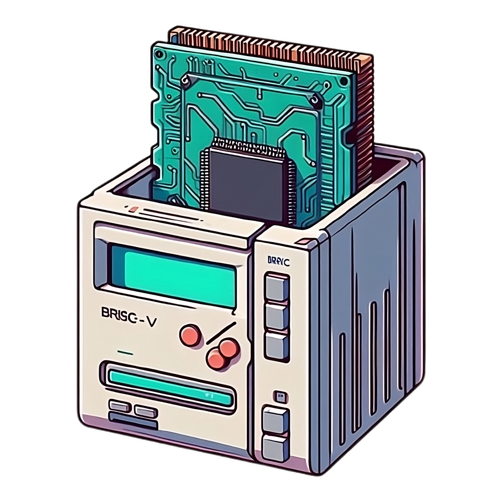

<h1>
  Brisc
  
  
  
</h1>

Brisc is a collection of libraries for running single-threaded RISC-V programs targeting the unprivileged
`riscv{32/64}i{mac}` ISAs.

`brisc` is in active development and is not ready for production use.

## Crates

Each crate builds on the one before it:

- [`brisc-isa`](./crates/isa): instructions, with their decoding, encoding and assembly.
- [`brisc-jit`](./crates/jit): a [Cranelift](https://cranelift.dev) compiler for RISC-V regions. It is a library
  for `brisc-hw`, not something you call yourself.
- [`brisc-hw`](./crates/hw): the hart, an interpreter with its registers, the `Memory` trait that it reaches memory
  and devices through, and a sparse RAM. With the `jit` feature it also compiles hot loops.
- [`brisc-emu`](./crates/emu): a hart on a memory and a kernel of your choice, sync or async, and an ELF loader.

## Contributing

See [`CONTRIBUTING.md`](./CONTRIBUTING.md)
